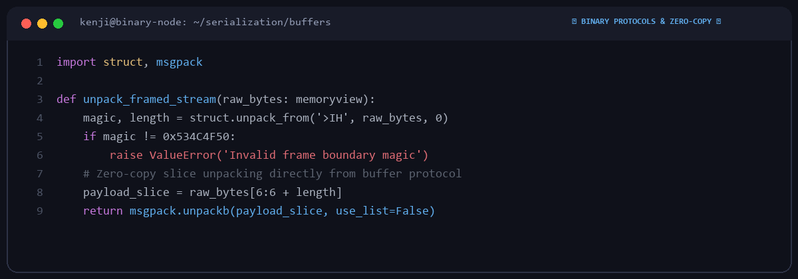

# Kenji Sato

  

Systems developer based in Tokyo, Japan.  
Focusing on binary serialization protocols, zero-copy buffers, and memory efficiency.

---

### 📦 Focus Areas

| Area | Technologies |
|---|---|
| **Binary Serialization** | Msgpack, Protocol Buffers, FlatBuffers, custom binary framing |
| **Memory Optimization** | `memoryview`, buffer protocols, reducing allocations in tight loops |
| **C Extensions & Cython** | Interfacing Python runtimes with native C libraries for high throughput |

---

### 🛠️ Methodologies

1. **Zero-Copy Where Possible**: Leveraging buffer protocols to avoid unnecessary memcpy overhead.
2. **Boundary Validation**: Strict bounds checking to prevent buffer underflows or memory corruption.
3. **Cross-Platform Verification**: Validating endianness and architecture-specific alignment.

---
*Python • C / Cython • Msgpack • Protobuf • Memory Buffers*